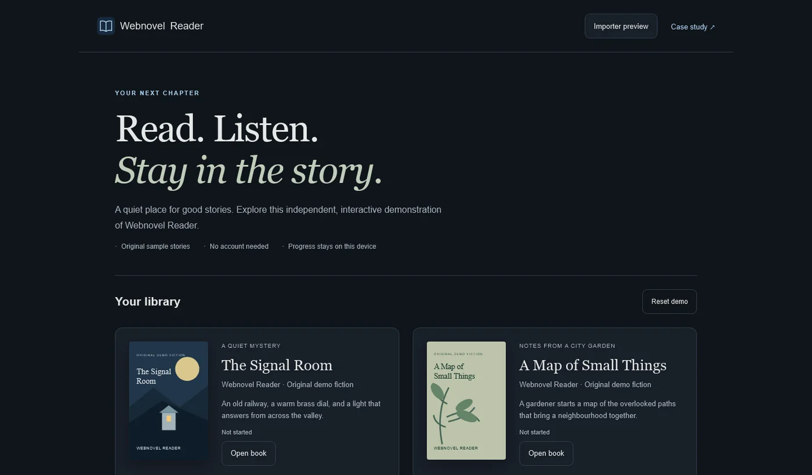
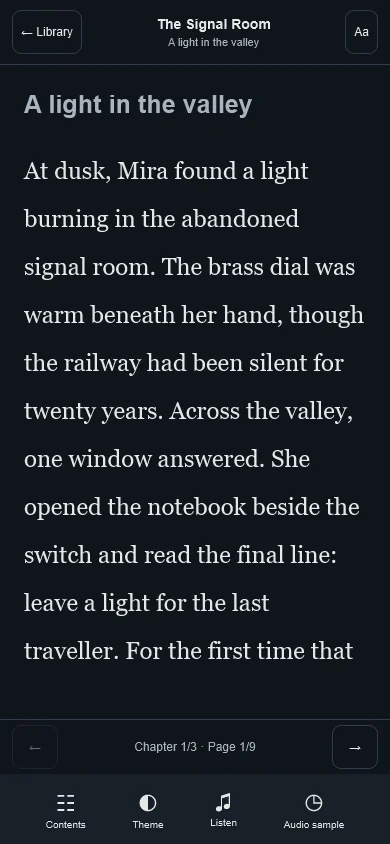
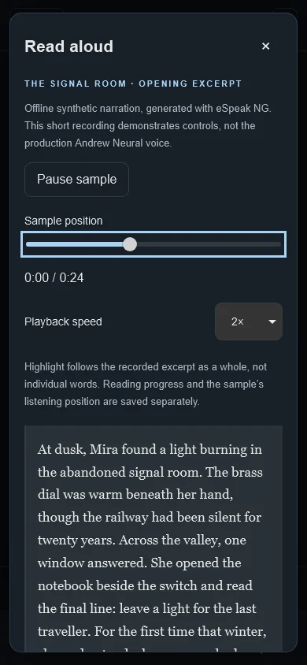
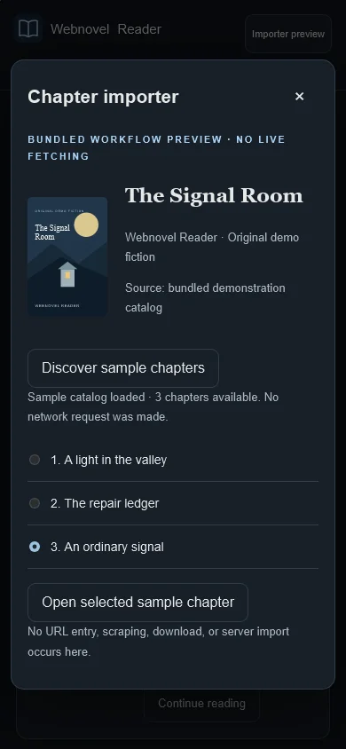
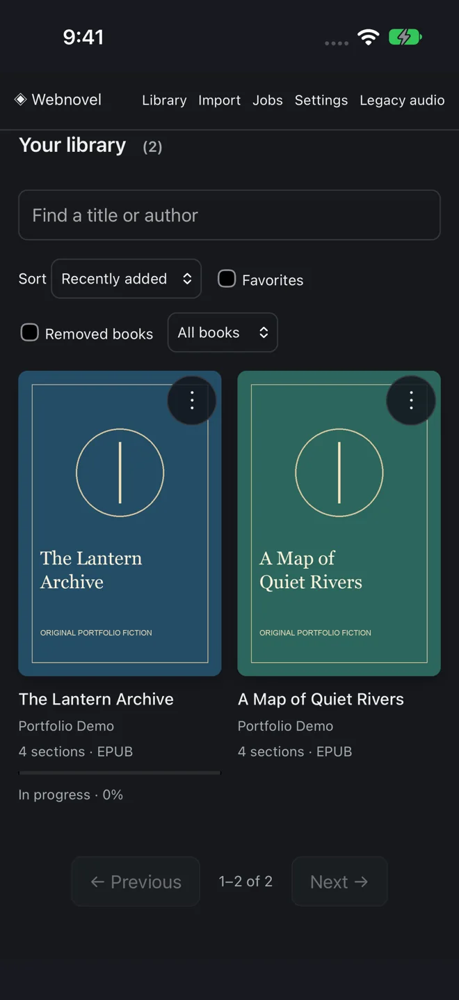
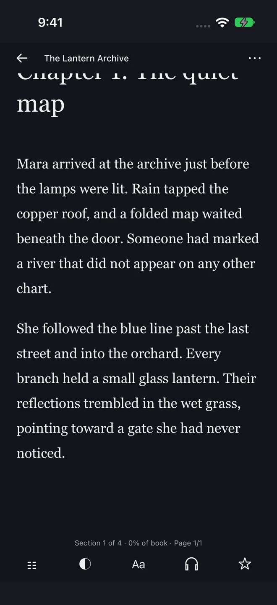
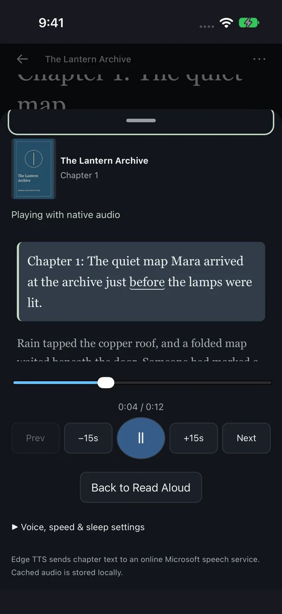
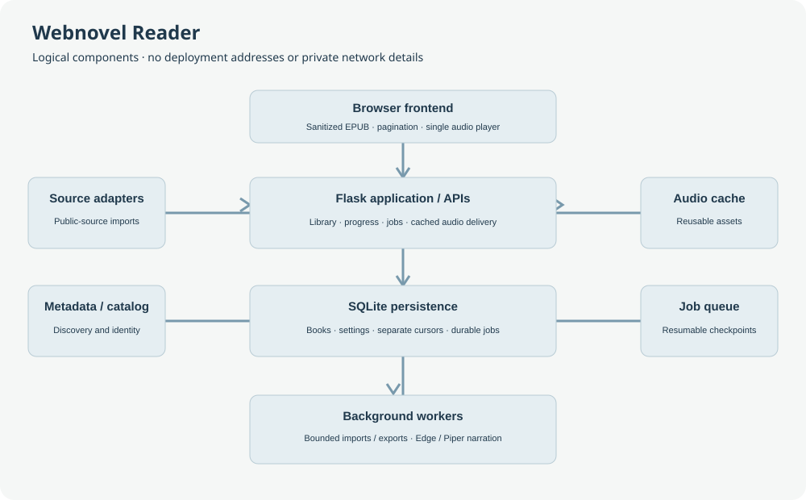

# Webnovel Reader

Web and native iPhone reading, durable listening checkpoints, and a self-hosted narration pipeline. [Portfolio case study](https://parampathak.com/projects/webnovel-reader/) · [Isolated browser demo](https://reader.parampathak.com/) · [Snapshot provenance](docs/PROVENANCE.md)

A self-hosted EPUB and webnovel reader with paginated reading, persistent progress, and on-demand audiobook narration. Python/Flask serves the library and durable job queue; a small JavaScript reader handles pagination and a single persistent audio player.

## Product preview

The [standalone interactive demo](https://webnovel-reader-demo.pages.dev) uses original sample stories, static narration, and browser-local state. It is separate from the self-hosted application: no private library, server connection, live scraping, or production speech service is exposed. The demonstration's synthetic voice is not Andrew Neural.

| Library | Immersive reading |
| --- | --- |
|  |  |

| Audio controls | Import workflow preview |
| --- | --- |
|  |  |

These are real captures of the independent demo, not private production-library screenshots. Audio highlights the recorded excerpt, not individual words; the importer uses bundled sample data. Original covers and prose are distributed with the demo.


## Native iPhone client

The Swift application combines WKWebView with AVQueuePlayer, background audio, lock-screen controls, protected cached segments and an append-only listening journal. Reading and listening checkpoints have separate ownership. Sequence checks and durable acknowledgement handling prevent a stale synchronization response from rewinding native playback.

| Library · iPhone simulator | Reading · iPhone simulator | Native audio · iPhone simulator |
| --- | --- | --- |
|  |  |  |

These are genuine captures of an isolated simulator build with original demo content and synthetic cached test audio. They contain no private library, real listening history or production configuration. The application is privately distributed through the owner's existing workflow; no App Store distribution is claimed.

The web application and audio/import workers run in Docker on Ubuntu Server. The native client calls the same Flask API and journals its listening intent locally before synchronizing independently versioned server checkpoints. See `NativeReader/`, [checkpoint architecture](docs/LISTENING-CHECKPOINTS.md), and [recorded release evidence](docs/progress.md). Building requires macOS and Xcode; local configuration and signing remain outside source control. The repository's default backend origin is an inert placeholder.

## Publication and security status

This candidate is prepared for review and remains private until the owner explicitly approves publication. Its source was copied from the real project, not replaced by a superficial sample. See [provenance](docs/PROVENANCE.md) for the honest snapshot boundary.

The original-code MIT license is retained. It does not relicense dependencies, books, artwork, voice models or generated audio. EbookLib, Piper and edge-tts have separate copyleft licenses; consult [third-party notices](THIRD_PARTY.md) before distributing a combined runtime or container. No production container, signing material or personal content is published by this snapshot.

## Features

- Import EPUBs or supported webnovel sources; browse chapters, search, bookmark, and export your own content.
- Readest-inspired page turning with touch swipes, edge taps, typography controls, gray/black/light-gray themes (plus original light/sepia), and stable text-anchor position recovery. Near-black is the default for books without an explicit theme; global and per-book choices persist.
- Mobile layouts for iPhone Safari and home-screen web-app use. Windows WebKit acceptance tests cover simulated iPhone sizes; this is not a physical-iPhone or offline-support guarantee.
- On-demand Microsoft Edge TTS narration, including Andrew Neural, selectable voices, 2× playback and ±15-second seeking. Piper provides a local synthesis option.
- Independent reading/listening positions, opt-in narration follow, and a compact player that disappears when headphones are turned off. Dismissing controls does not stop listening.
- Expanded Read Aloud controls with a real chapter timeline, variable-duration chunk seeking, nearby narrated passages, immediate playback speed changes, and active-browser sleep deadlines.
- Independent Back to Read Aloud navigation, controls that hide after 4.5 seconds, lower-area vertical reveal/hide gestures, and a stable reading viewport.
- Headphones OFF hands control to manual reading: the next headphones ON starts from the current reading anchor. Pausing with headphones ON instead retains the listening cursor. Reader mini-player titles expand controls; library mini-player titles return to the listening location.
- New Edge recordings retain genuine word-boundary cues tied to their audio checksum and text. The media clock drives highlighting and page following. Older caches without cues remain usable at chunk precision; they are not silently regenerated or given estimated word timings. Starting inside such a chunk can replay its preceding text.
- Optional per-book automatic new-chapter imports from supported public FreeWebNovel and Royal Road catalogs. Existing books remain off until selected.
- Source-aware metadata, manual overrides, live discovery status, and identity-safe chapter catalog updates. Manual NovelFull importing is supported separately from the automatic updater; see [source support and restrictions](SOURCE_SUPPORT.md).
- Full-height Contents with a 100-row window over long chapter lists; scrolling loads the relevant window rather than rendering thousands of rows.
- Reusable generated-audio cache and conservative daily maintenance with a configurable 20 GiB default budget, dry-run, bounded batches, and durable interruption recovery.

No third-party Readest source or assets are bundled. Reading behavior is independently implemented. New recordings can use genuine, checksum-bound word cues; older recordings retain chunk-level highlighting without invented timing data.

## Architecture



| Component | Responsibility |
| --- | --- |
| `app.py`, `library_api.py`, `platform_api.py` | Web pages, library/progress APIs, cached audio/range responses |
| `library_store.py`, `platform_store.py` | SQLite migrations, durable jobs and separately versioned progress |
| `platform_worker.py` | On-demand Edge narration, imports and exports |
| `worker.py` | Legacy/local synthesis worker |
| `audio_providers.py`, `edge_connection.py` | Existing Edge SDK integration and compatibility adapter |
| `audio_cache.py` | Access recency, stream protection and bounded maintenance |
| `chapter_updates.py` | Opt-in sequential chapter checks, durable catalog checkpoints and append-only imports |
| `static/`, `templates/` | Reader, long-list windowing and persistent single audio player |

Runtime data lives under `DATA_DIR`: SQLite, imported books/text, covers, generated audio, voices and temporary files. Keep this directory private. Backups belong in `BACKUP_DIR`, separately mounted. The source repository does **not** contain an audiobook library, production configuration, credentials, or operational history.

## Docker

Copy `.env.example` to `.env` and choose local storage locations. The supplied Compose file starts the web application, Edge/import worker and local-synthesis worker. Optional Kokoro is an explicitly enabled profile.

```sh
docker compose -f compose.example.yaml up -d --build
```

Open `http://localhost:5000`. Keep the service on a trusted network; it is not a hardened public multi-user service. For access outside that network, configure authentication and HTTPS in your own reverse proxy. Do not expose a staging environment or worker ports publicly.

The Microsoft speech service is an online dependency, not a promised SLA or paid Azure integration. Respect applicable service terms and rights to the text being narrated. The existing compatibility adapter uses the SDK's public client configuration; no personal API credential is included.

## Local development

Use Python 3.12 and Node.js 22 or newer. Linux is needed for the server's file-locking and worker/resource-safety implementation; on Windows, use Docker for the backend and native Windows Playwright WebKit for browser tests.

```sh
python -m venv .venv
. .venv/bin/activate
pip install -r requirements.txt
DATA_DIR=./data BACKUP_DIR=./backups START_TTS_WORKERS=0 python app.py
```

Run workers separately only when needed. Install FFmpeg for audio assembly/probing and espeak-ng for the legacy fallback; configure/install a Piper voice before selecting it. Do not use production data for development tests.

## Configuration

`.env.example` contains placeholders/defaults only. Compose maps these values into the appropriate services; direct Python launches read environment variables.

| Variable | Default/purpose |
| --- | --- |
| `WEB_BIND`, `WEB_PORT` | Loopback bind and port 5000 |
| `DATA_PATH`, `BACKUP_PATH` | Host runtime and backup directories |
| `DATA_DIR`, `BACKUP_DIR` | Container/runtime storage roots |
| `AUDIO_CACHE_LIMIT_GIB` | Generated-audio budget, default 20 GiB |
| `AUDIO_CACHE_CLEANUP_ENABLED` | `1` enables web-process daily maintenance; default `0` |
| `AUDIO_CACHE_DRY_RUN` | Default `1`; set `0` only after reviewing a dry-run |
| `CHAPTER_UPDATES_ENABLED` | Default `1`; starts the lightweight web-process updater. Per-book automatic updates are still off by default. |

## Listening and immersive reading

Headphones switch listening on or off. Off pauses the same media element, closes the listening view, clears narration marks, and keeps the visible reading page. Returning without reading elsewhere resumes the precise paused position; reading elsewhere while off starts from that visible text anchor next time. Blue headphones mean actual playback.

Tap the compact player's title or cover to open the expanded view. Its controls share the original audio element. Dragging previews the chapter time and commits a seek on release using measured, cumulative segment durations. Unknown future duration is constrained to available audio; complete recordings with incomplete chunk metadata use native file timing and explicitly omit unsupported passage highlighting. New Edge recordings with verified cues follow the media clock at word level; older recordings remain chunk-precision. Back to Read Aloud returns to the spoken passage without seeking audio.

Playback includes 1×, 1.5×, 2× and 2.5×, retains the saved preference, and does not synthesize again when only playback speed changes. Sleep offers Off, 5, 10, 15, 30 and 60 minutes. iOS may suspend browser timers in the background; the deadline is enforced on resume rather than promising a native background alarm.

Controls hide after 4.5 seconds without changing pagination or pausing narration. Swipe up from the lower reading area or use the visible reveal button to show them; swipe down or use the C keyboard shortcut to hide them. Menus and the expanded player remain open during interaction.

## Automatic new-chapter imports

Open a book's details and find **Auto-import new chapters**. Select that book, choose an interval (24 hours by default, configurable from 12 hours to 7 days), or use **Check for new chapters** while automatic updates are off. The panel shows the canonical source, check time, result and added chapter count.

The existing importer source is reused when unambiguous, including verified original legacy chapter URLs. A replacement source requires matching stable chapter identities; titles alone never establish identity. EPUBs without a verified supported online source remain ineligible. Other manual importer adapters are preserved, but automatic updates currently support public FreeWebNovel and Royal Road catalogs only.

Checks run on the server even when the browser is closed. One process holds a shared file lease and performs one bounded operation per tick. Catalog state, pending imports and checkpoints persist across restart. Normal checks are bounded to 100 catalog pages, 10,000 chapter identities and 100 new releases. Administrative Check Now calls can request tighter `max_pages` and `max_new` limits. Excessive, incomplete or ambiguous catalogs stop safely with a visible retryable status.

The baseline is the last known catalog chapter, not the number of imported sections. A partial 3,200-chapter history therefore does not backfill old chapters automatically. New releases append in source order using stable source IDs and database uniqueness; existing chapter text, IDs, bookmarks, preferences, listening/reading progress and audio are retained. Updates never request speech synthesis. Failures back off, and an unavailable book does not block other books. Source access uses the existing robots-aware, timeout-limited, DNS-pinned public HTTP importer without bypassing access controls.

## Cache safety and maintenance

Actual successful audio requests update recency at most once per five minutes per asset. The current listening chapter (all its voice variants) and requests in progress are protected. Any running generation/export job postpones eviction. Queued/paused/failed resumable synthesis is also protected.

Only complete, canonical Edge assets with unchanged source identity and verified chunk checksums are eligible. Partial/unregistered files and preserved legacy/Piper assets count toward the budget but are retained because the historical registry does not prove safe regeneration/invalidation. Thus the budget is **best effort**, not permission to delete protected or unproved data. Reports identify unreclaimable/over-budget conditions.

LRU order prefers retaining the ten most recently accessed chapters per book; current playback and accesses within 24 hours are hard protections. Deletion is limited to 256 files, 32 MiB and 20 seconds per run; oversized assets are skipped. Metadata consistency uses durable eviction intent and bounded recovery. Safe directory descriptors prevent symlink traversal or deletion outside the approved audio tree.

The scheduler performs no initial cleanup: its first attempt is one day after web startup. It runs once daily, never generates audio, and logs before/after size, planned/removed files, reclaimed bytes, protections and errors. Under-budget runs use file metadata only, without hashing audio. Disabling/restarting the web service stops its scheduler; no external cron is installed.

```sh
# Default: dry-run, no deletion
docker compose -f compose.example.yaml exec webnovel-app python audio_cache.py
# Explicitly apply ONE bounded batch after reviewing the report
docker compose -f compose.example.yaml exec webnovel-app python audio_cache.py --apply
```

Books, text, covers, preferences, progress, bookmarks, databases and voice models are never eviction targets. Removing eligible generated audio preserves its original voice/settings and chunk plan, so requesting it again follows the existing worker's regeneration path. Back up data before enabling deletion; do not run a large initial purge.

## Tests

```sh
node --test tests/js/*.test.cjs
START_TTS_WORKERS=0 AUDIO_CACHE_CLEANUP_ENABLED=0 python -m unittest discover -s tests -t .
```

Cache destruction tests use synthetic temporary data, never production. Optional workstation pagination checks are in `tools/verify_paginated_browser.py`; they require private disposable staging on localhost port 15000 and an existing test library/cache. Do not aim mutation tests at production. Native browser acceptance must be repeated for a candidate's exact served assets before deploying UI changes; unit tests alone are insufficient.

GitHub Actions runs lightweight backend/frontend and syntax checks against isolated fixtures. It neither connects to a private server nor deploys production. Real speech-service tests are separately controlled; CI does not synthesize books or incur service charges.

Use an isolated Linux environment for backend tests, with development-only data and backup paths. Large fixture imports deliberately retain resource guards and can stop under memory or swap pressure. The complete suite, rather than only selected classes, runs on the hosted CI runner. A fresh Docker installation is documented above but is not claimed as newly tested by this documentation update.

## Deployment and rollback

Build an immutable image after staging tests pass. Back up SQLite using its backup API, verify integrity, record existing images/configuration, and check host pressure. Update only the web service when workers/providers are unchanged, using `--no-deps`; preserve data mounts and retained prior images. Verify health, exact tested asset hashes, progress and cached narration, then run a bounded cleanup dry-run. Roll back by restoring the previous web image/configuration against current data—not by resetting reading progress or deleting caches.

Do not automate production deployment through GitHub Actions. Scan proposed commits **and their reachable history** before publishing; `.gitignore` does not remove secrets from existing history.

## Security and licensing

EPUB content is untrusted: sanitization and an inner `script-src 'none'` CSP block scripts/inline handlers, including inside the reader iframe. Do not weaken the CSP or assume iframe sandbox tokens alone provide isolation. Import requests reject private/loopback destinations and redirects. Limit trusted-network access and keep backups secure.

The existing repository's MIT license is retained. Dependencies have their own licenses; see `THIRD_PARTY.md`. No imported books, generated narration, fonts, copied Readest assets or private operational screenshots are distributed. You are responsible for having permission to import, narrate and share content.
